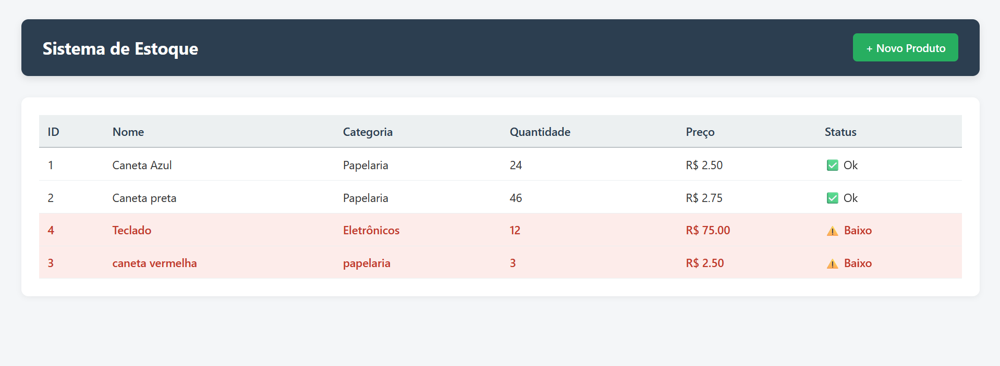
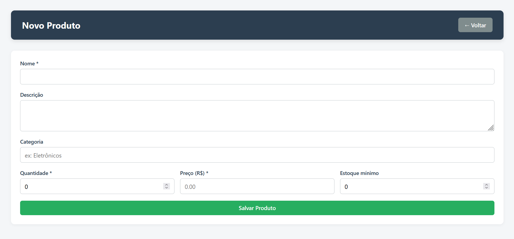

# 📦 Sistema de Estoque

Um sistema web simples de controle de estoque, construído com Flask e SQLite.

Permite cadastrar e visualizar produtos, com alerta visual automático para itens abaixo do estoque mínimo. Desenvolvido como peça de portfólio para Análise e Desenvolvimento de Sistemas.




## Highlights

- Cadastro e listagem de produtos (CRUD parcial).
- Alerta visual para produtos com estoque baixo.
- Preço formatado em Real (R$).
- Interface responsiva (desktop e celular).
- Banco de dados local — zero configuração.

## Requirements

- Python 3.10+
- Git

O SQLite já vem embutido no Python.

## Quick Start

```bash
git clone https://github.com/FelipeAaugusto/sistema-estoque.git
cd SEU_REPOSITORIO

python -m venv venv

# Windows
.\venv\Scripts\Activate.ps1
# Mac / Linux
# source venv/bin/activate

pip install -r requirements.txt
python app.py

Abra em http://127.0.0.1:5000.
Structure
text

sistema-estoque/
├── app.py
├── estoque.db              # gerado automaticamente
├── requirements.txt
├── templates/
│   ├── index.html
│   └── form_produto.html
└── static/
    └── css/
        └── style.css

Usage
Rota	Método	Ação
/	GET	Lista produtos
/produtos/novo	GET	Exibe formulário
/produtos/novo	POST	Salva produto

Regra de alerta: linha em vermelho quando quantidade <= estoque_minimo.
Configuration

Sem configuração externa. O banco estoque.db é criado na primeira execução.

Para renomear, edite em app.py:
python

DATABASE = 'estoque.db'

Development
bash

pip install -r requirements.txt
python app.py

Roda com debug=True (auto-reload). Apenas em desenvolvimento.
Roadmap

    ☑

    Cadastro e listagem de produtos
    ☑

    Alerta de estoque baixo
    ☑

    Interface responsiva
    □

    Edição e exclusão de produtos
    □

    Busca e filtro por categoria
    □

    Histórico de movimentações